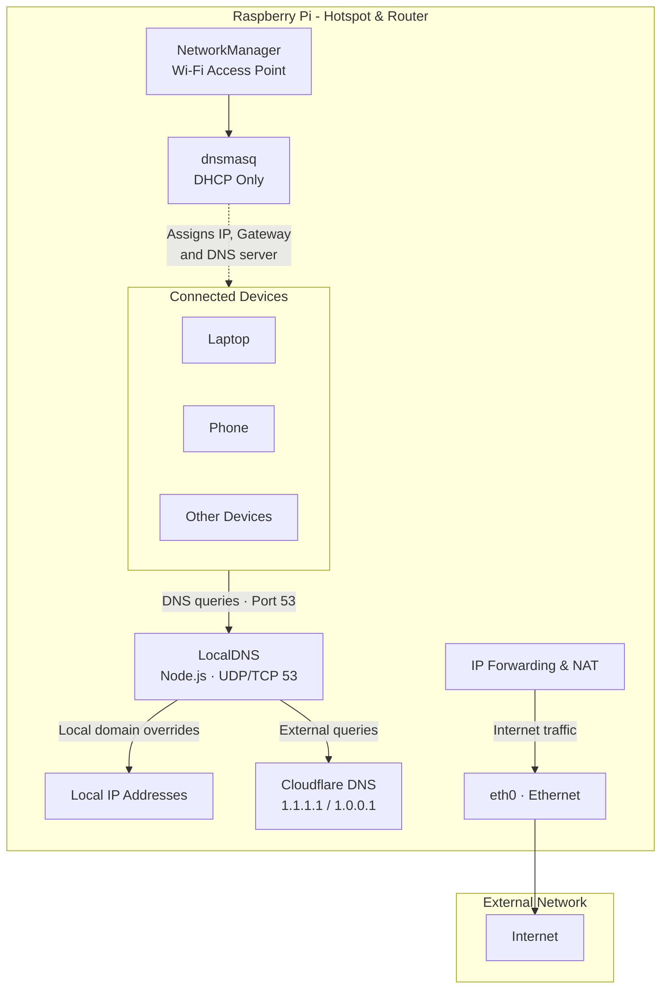

# LocalDNS

A lightweight, configurable DNS server built with Node.js, featuring a modern web UI for managing local DNS overrides. Resolve custom home lab domains to local IP addresses while forwarding all other queries to public DNS resolvers.

## Why

While setting up my home lab, I wanted to give devices and services on my local network custom domain names without having to purchase a domain or rely on an external DNS provider.

So I built LocalDNS: a DNS server that allows me to reserve domain names for local services and map them to specific IP addresses.

For example, querying `lab.pi` returns `10.42.0.1`, while all other DNS queries are forwarded to Cloudflare's public DNS resolvers.

## How It Fits Into My Home Lab

LocalDNS runs directly on my Raspberry Pi, which also acts as the Wi-Fi hotspot and router for my home lab network.

The networking stack is split into three responsibilities:

1. **NetworkManager** manages the Wi-Fi access point and creates the hotspot network.
2. **dnsmasq**, managed by NetworkManager, handles DHCP and assigns IP addresses to connected devices. Its DNS functionality is disabled.
3. **LocalDNS** handles all DNS queries directly on port `53`, resolving local overrides and forwarding everything else to Cloudflare.

### Network Architecture



### DNS Resolution Flow

```text
Client
  |
  | DNS query (port 53)
  v
LocalDNS (10.42.0.1:53)
  |
  +-- lab.pi ----------> 10.42.0.1
  |
  +-- anything else --> Cloudflare DNS
                          1.1.1.1 / 1.0.0.1
```

Clients receive their DNS server address (`10.42.0.1`) automatically through DHCP. They communicate directly with LocalDNS instead of going through dnsmasq for DNS forwarding.

## Requirements

- Node.js
- npm
- Linux (tested on Raspberry Pi OS)
- NetworkManager (for the hotspot integration)

## Installation

Clone the repository and install dependencies:

```bash
git clone <this-repo>
cd localDNS
npm install
```

### Dependencies

- [dns2](https://www.npmjs.com/package/dns2) - DNS server implementation.
- [express](https://www.npmjs.com/package/express) - Web UI backend.

## Running

### Start LocalDNS and the Web UI

```bash
sudo node dnsServer.js
```

This starts both the DNS server and web UI in one process, so live device tracking and device controls share the DNS server's state directly. No separate monitor process is needed. `npm start` runs the same entry point when your user already has permission to bind the DNS port.

Open the web interface at [http://localhost:4242](http://localhost:4242). The web UI allows you to monitor devices, manage domain overrides, change DNS settings, and delete historical log files without manually editing the configuration file.

The DNS server listens on the configured port (default `53`) over both UDP and TCP. If you do not use `sudo`, port 53 requires the Node.js binary to have permission to bind privileged ports. You can grant that capability instead:

```bash
sudo setcap 'cap_net_bind_service=+ep' "$(readlink -f "$(which node)")"
```

## Network Configuration

LocalDNS is designed to work alongside NetworkManager's hotspot implementation.

### NetworkManager Hotspot

The Raspberry Pi hotspot uses the following configuration:

| Setting | Value |
|---|---|
| Interface | `wlan0` |
| SSID | `The Den` |
| Gateway | `10.42.0.1` |
| Subnet | `10.42.0.0/24` |
| DHCP range | `10.42.0.10 - 10.42.0.254` |
| DNS server | `10.42.0.1` |

NetworkManager manages the access point and starts its own dnsmasq instance for DHCP.

### Disable dnsmasq DNS

Create the following configuration file:

`/etc/NetworkManager/dnsmasq-shared.d/dhcp-only.conf`

```ini
# Disable DNS functionality.
port=0

# Advertise LocalDNS as the DNS server through DHCP.
dhcp-option=option:dns-server,10.42.0.1
```

This keeps DHCP operational while disabling dnsmasq's DNS listener.

LocalDNS can then bind to the standard DNS port (`53`) without conflicting with dnsmasq.

Restart the hotspot after changing the configuration:

```bash
sudo nmcli connection down Hotspot
sudo nmcli connection up Hotspot
```

Clients should reconnect to obtain their DHCP configuration.

## Configuration

All DNS configuration is stored in `config.json`.

You can modify it directly or use the web interface.

### Example Configuration

```json
{
  "dns": {
    "port": 53,
    "bind": "0.0.0.0",
    "upstream": [
      "1.1.1.1",
      "1.0.0.1"
    ]
  },
  "overrides": [
    {
      "id": "lab-pi",
      "enabled": true,
      "name": "lab.pi",
      "type": "A",
      "value": "10.42.0.1",
      "ttl": 60,
      "notes": "Home lab server"
    }
  ]
}
```

### Supported DNS Records

| Record | Description |
|---|---|
| `A` | Maps a domain to an IPv4 address. |
| `AAAA` | Maps a domain to an IPv6 address. |
| `CNAME` | Maps a domain to another domain name. |

LocalDNS watches `config.json` for changes and automatically reloads its configuration.

### Via Web UI

1. Start LocalDNS and the web UI using `sudo node dnsServer.js`.
2. Open `http://localhost:4242`.
3. Add, edit, or remove domain overrides.
4. Save your changes.

Configuration changes are automatically picked up by the DNS server. To delete a log, open **Log History**, select the file, and click **Delete Log**.

## Project Structure

```text
localDNS/
├── dnsServer.js       # Integrated DNS server and web UI entry point
├── dnsMonitor.js      # Web portal and monitoring API
├── logger.js          # Shared query logging and device tracking
├── config.json        # DNS configuration and overrides
├── public/            # Web UI frontend
│   ├── index.html
│   ├── style.css
│   └── app.js
└── lib/
    └── resolver.js    # Standalone DNS resolution helper
```

`lib/resolver.js` is a standalone helper and is not currently used by the main DNS server.

## Limitations

- **DNS-over-HTTPS (DoH):** Some browsers and applications use their own DNS resolvers, bypassing the system DNS configuration. Local overrides may not resolve in these applications unless secure DNS is disabled or configured to use the local resolver.
- **No caching:** DNS responses are not currently cached, so repeated external queries are forwarded to upstream resolvers.
- **Single upstream strategy:** External queries are forwarded to the configured Cloudflare resolvers.

## References

- [Node.js DNS Documentation](https://nodejs.org/api/dns.html)
- [dns2 - npm](https://www.npmjs.com/package/dns2)
- [dnsmasq Documentation](https://thekelleys.org.uk/dnsmasq/doc.html)
- [NetworkManager Documentation](https://networkmanager.dev/docs/)

---

Built for my home lab. No external domain required, just local DNS and a Raspberry Pi.
